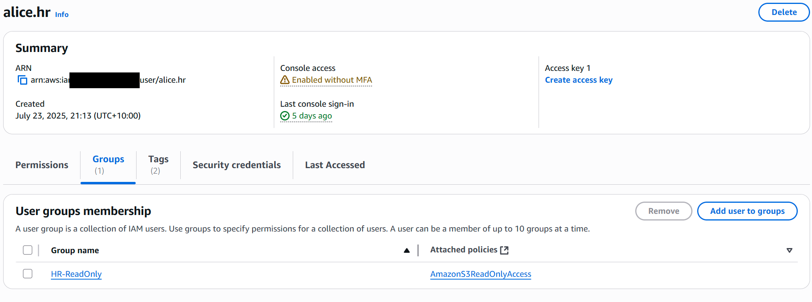
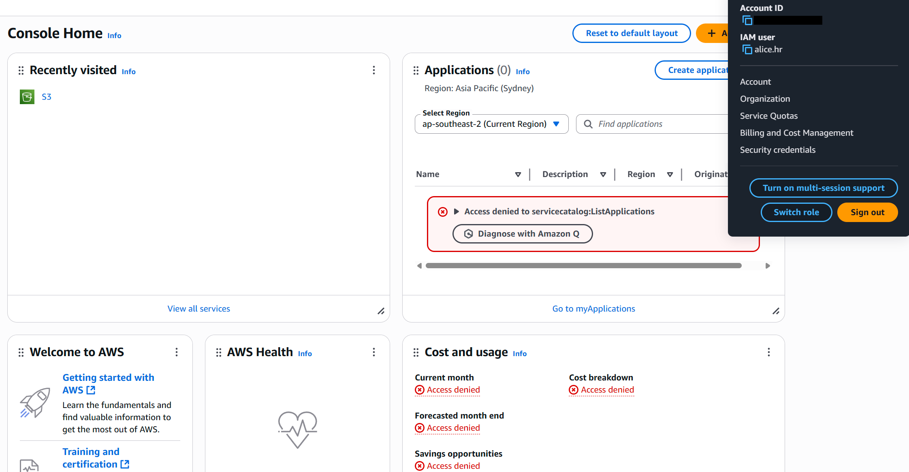
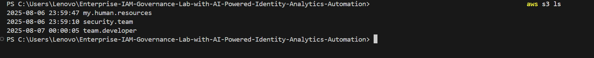
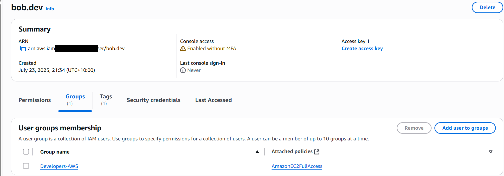
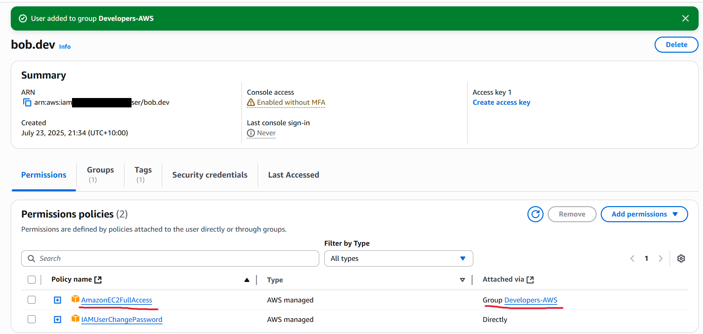
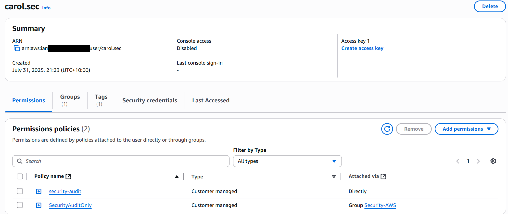
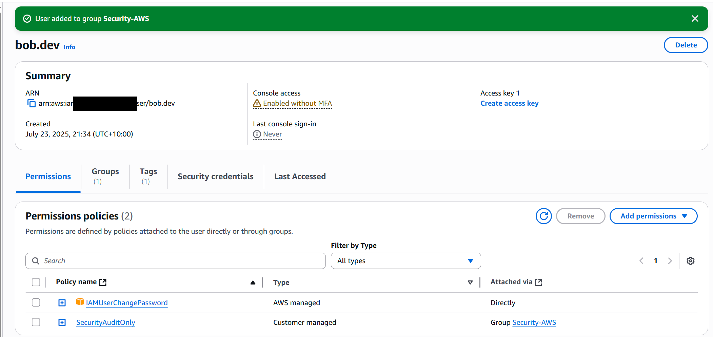
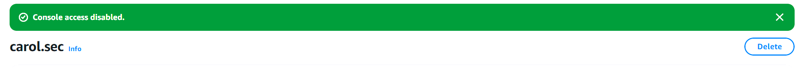
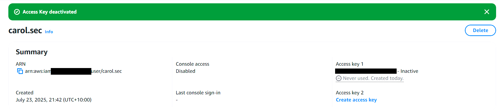
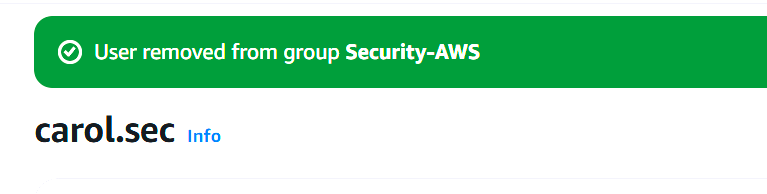

## 🧩 Phase 0: Project Setup (Before You Begin)

### ✅ Prerequisites to Install/Setup

| Tool                       | Purpose                                | How to Get It                                                                 |
|---------------------------|----------------------------------------|-------------------------------------------------------------------------------|
| **AWS Free Tier**         | For IAM, SSO, CloudTrail               | [Create an AWS Account](https://aws.amazon.com/free/)                         |
| **Microsoft Entra ID**    | Identity governance simulation         | [Create Microsoft Entra ID](https://www.microsoft.com/en-au/security/business/identity-access/microsoft-entra-id) |
| **Visual Studio Code**    | Code editing, Git, Python              | [Download VS Code](https://code.visualstudio.com/)                            |
| **Git**                   | Version control + GitHub push          | [Install Git](https://git-scm.com/)                                           |
| **Python 3.11+ (3.12 recommended)** | Automation scripting       | [Install Python](https://www.python.org/downloads/)                           |
| **Jupyter / Google Colab**| AI Notebooks (Optional)                | [Open Google Colab](https://colab.research.google.com/)                       |
| **GitHub Repository**     | Showcase project online                | [Create a GitHub Repo](https://github.com/new)                                |

## 🔹 Phase 1 – Manual Joiner Setup (Identity Lifecycle Simulation)

In this phase, we manually provision IAM users via the AWS Console to understand the identity lifecycle before implementing automation in later phases.

> **2026 review note.** The screenshots show the original 2025 run of this lab (account/key IDs redacted). The steps below were updated after a security review:
> - **No access keys for people.** Workforce users get console access only, protected by MFA. Automation uses roles with temporary credentials.
> - **MFA is mandatory** (`enforce-mfa.json` denies almost everything until MFA is used).
> - **Least privilege:** `ec2-admin.json` (`ec2:*` on `*`) was replaced by `ec2-developer.json`, and `s3-readonly.json` is now scoped to the user's own department buckets (ABAC on the `department` tag).
> - **In production**, people would sign in through **IAM Identity Center** federated with an IdP (e.g. Microsoft Entra ID) and receive permission sets, not IAM users. This lab uses IAM users only to make the lifecycle visible.

---

### 🔧 Step-by-Step: Creating `alice.hr` (Joiner Simulation)

1. **Click “Create user”**  
   - Top-right orange button in AWS IAM Console.

2. **Set User Details**

   | Field                | Value                              |
   |----------------------|------------------------------------|
   | User name            | `alice.hr`                         |
   | Access type          | ✅ Console access only (no access keys) |
   | Console password     | Autogenerated                      |
   | Require reset        | ✅ Enabled                          |

   → Click **Next: Permissions**

3. **Assign to Group**

   - Click **Create group**  
   - Group Name: `HR-ReadOnly`  
   - Attach Policy: custom `s3-readonly.json` (department-scoped). Avoid `AmazonS3ReadOnlyAccess`: it can read **every** bucket in the account
   - Click **Create group**  
   - Select the group and proceed

4. **Add Tags**

   | Key         | Value |
   |-------------|--------|
   | department  | hr     |

   → Click **Next: Review**

5. **Review & Create**

   - Username: `alice.hr`  
   - Group: `HR-ReadOnly`  
   - Policy: `s3-readonly.json` + `enforce-mfa.json`
   - Tag: `department=hr`  
   → Click **Create User**

6. **Hand over credentials securely**

   - ⚠️ Do **not** download the credentials .CSV or keep it in the project folder (it is git-ignored, but should not exist at all)
   - Share the one-time password through a secure channel (password manager share or Secrets Manager); the user must reset it at first sign-in
   - The user registers an MFA device (passkey/security key preferred) at first sign-in

7. **Test Access**

   - Log in via AWS Console with `alice.hr`
   - Try browsing S3 buckets  
   - ✅ Confirm read-only access (no upload/delete)
   - ✅ Confirm buckets of **other** departments are denied (the original version failed this check: alice.hr could list `security.team` and `team.developer`)
  

---

### 👨‍💻 Step-by-Step: Create `bob.dev` – Cloud Developer

Provision a developer user with EC2 access.

#### 📋 Configuration

| Field     | Value                                              |
|-----------|----------------------------------------------------|
| Username  | `bob.dev`                                          |
| Group     | `Developers-AWS`                                   |
| Policy    | custom `ec2-developer.json` + `lambda-developer.json` |
| Tag       | `department=development`                           |

#### 🛠️ Steps

1. Go to **IAM > Users > Add user**
2. Enter username: `bob.dev`
3. Enable:
   - ✅ AWS Management Console access (no programmatic access keys)
4. Set password to:
   - Autogenerated
   - ☑ Require password reset
5. **Create Group** (if not already created):
   - Group name: `Developers-AWS`
   - Attach the custom policies `ec2-developer.json`, `lambda-developer.json` and `enforce-mfa.json`
   - ❌ Avoid `AmazonEC2FullAccess` / `ec2:*`: it allows sharing EBS snapshots with other accounts, opening security groups to the internet and reading instance passwords
6. **Add Tag**  
   - Key: `department`  
   - Value: `development`
7. **Review & Create**
   - Confirm:
     - Username: `bob.dev`
     - Group: `Developers-AWS`
     - Tag: `department=development`
   - Click **Create User**

#### ✅ Test Bob’s Access (CLI) optional

aws ec2 describe-instances

---

### 🛡️ Step-by-Step: Create `carol.sec` – Security Analyst

Provision a security analyst with read-only access to IAM, CloudTrail, logs, and org metadata.

#### 📋 Configuration

| Field     | Value                     |
|-----------|---------------------------|
| Username  | `carol.sec`               |
| Group     | `Security-AWS`            |
| Policy    | Custom `security-audit.json` |
| Tag       | `department=security`     |

#### 🛠️ Steps

1. Go to **IAM > Users > Add user**
2. Enter username: `carol.sec`
3. Enable:
   - ✅ AWS Management Console access (no programmatic access keys)
4. Set password to:
   - Autogenerated
   - ☑ Require password reset
5. **Create Group** (if not already created):
   - Group name: `Security-AWS`
   - Attach custom policies: `security-audit.json` and `enforce-mfa.json`
6. **Add Tag**  
   - Key: `department`  
   - Value: `security`
7. **Review & Create**
   - Confirm:
     - Username: `carol.sec`
     - Group: `Security-AWS`
     - Tag: `department=security`
   - Click **Create User**

## 🔄 Phase 1B: Simulate Mover & Leaver in AWS IAM

---

### 🔁 MOVER: Bob changes roles (Dev → Security Analyst)

👨‍💻 **Scenario**:  
Bob was a Developer, but is now transferring to the Security team. We need to:
- Remove him from `Developers-AWS` group  
- Add him to `Security-AWS` group  
- Revoke credentials issued under his old role (required, not optional)  

---

#### ✅ Step-by-Step: Bob's Role Change

1. Go to **IAM > Users > bob.dev**
2. Click **Groups** → Remove from `Developers-AWS`  
   - Click the ✖️ next to `Developers-AWS` to remove him  
3. Click **Add user to groups**  
   - Select or create `Security-AWS`  
   - Click **Add to groups**  
4. **Revoke old-role credentials (required)**:  
   - Deactivate any access keys he had as a developer  
   - Require Bob to reset his password  
   - Update his `department` tag to `security` (ABAC policies read it)  

✅ **Bob now has access equivalent to a Security Analyst instead of Developer.**

---

### 🧹 LEAVER: Carol leaves the organization

👩‍💼 **Scenario**:  
Carol (Security Analyst) is leaving the company. We need to:
- Block **everything** immediately (deny-all first, so nothing slips through while we clean up)  
- Revoke console access, access keys and any other credentials  
- Keep the disabled record for the retention period, then delete it  

---

#### ✅ Step-by-Step: Carol Offboarding

1. Go to **IAM > Users > carol.sec**
2. **Permissions → Add permissions → Create inline policy**: paste `leaver-quarantine-deny-all.json` (explicit deny beats every allow)
3. In **Security credentials** tab:  
   - Under **Console access**, click “**Make inactive**”  
   - Under **Access keys**, click “**Deactivate**” (or **Delete** if preferred)  

4. Remove Carol from all groups:  
   - Click **Groups**  
   - Remove from `Security-AWS`  

5. Tag her `lifecycle-status=terminated` with the date, and **delete the user only after the retention period** (30 days in this lab; often 30–90 days in real organisations).  
✅ **Carol now has no access, and her identity is decommissioned.**

---

### ✅ Results Summary

| User       | Old Role         | Action Taken                         | Result                          |
|------------|------------------|--------------------------------------|---------------------------------|
| `bob.dev`  | Developer         | Moved to `Security-AWS` group        | Now acts as Security Analyst    |
| `carol.sec`| Security Analyst  | Access revoked, optionally deleted   | No longer active in IAM         |

