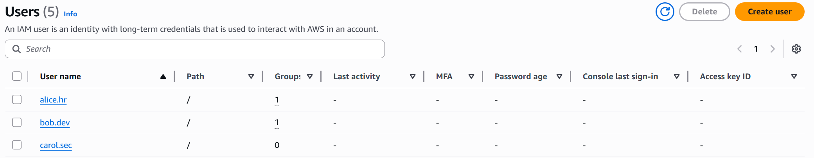

## Phase 2: Joiner Automation with Python + Boto3

### Objective

Automate the **Joiner** stage: provision new workforce identities from a CSV in a way that is repeatable, least-privilege and auditable.

---

### Files

| File | Purpose |
|---|---|
| `bootstrap.py` | Creates/refreshes the managed policies (from the Phase 1 JSON files), the three RBAC groups under `/iamlab/`, and the account password policy. Idempotent; also removes unexpected policies from the groups (drift correction). |
| `validate_csv.py` | Validates a CSV **without calling AWS**: required columns, username format, role exists in the catalog, ticket reference, duplicates, spreadsheet-formula injection. |
| `Joiner.py` | Provisions the users in `Joiner.csv`. |
| `Joiner.csv` | Input: `username,role,ticket` |

```csv
username,role,ticket
alice.hr,hr-analyst,HR-1001
bob.dev,developer,HR-1002
carol.sec,security-analyst,HR-1003
```

Roles are defined in `iam_lifecycle/config.py`:

| Role | Group | `department` tag | Policies (plus `iamlab-enforce-mfa`) |
|---|---|---|---|
| `hr-analyst` | `HR-ReadOnly` | `hr` | `iamlab-s3-department-readonly` |
| `developer` | `Developers-AWS` | `development` | `iamlab-ec2-developer`, `iamlab-lambda-developer` |
| `security-analyst` | `Security-AWS` | `security` | `iamlab-security-audit` |

---

### What the Joiner does for each row

1. Skips the user if they already exist (safe to re-run).
2. Creates the user under `/iamlab/` **with the permissions boundary and tags in the same call** (`department`, `role`, `ticket`, `lifecycle-status=active`).
3. Adds the user to the role's group. Permissions come from the group only; nothing is attached to the user.
4. Optional `--console-access`: creates a random one-time password with *reset required*, stores it in Secrets Manager at `iamlab/onboarding/<username>`, and never prints it.
5. If any step fails, the half-created user is rolled back.
6. **Never** creates access keys.

Every step is written to `audit-logs/<date>.jsonl`.

---

### How to run

1. **Authenticate without static keys** (recommended):
   ```bash
   aws configure sso          # creates a profile backed by IAM Identity Center
   aws sso login --profile iamlab
   ```
   Optionally run as the least-privilege operator role (`jml-automation-operator.json`) with `--role-arn`.

2. **Validate the CSV** (no AWS calls):
   ```bash
   python validate_csv.py
   ```

3. **Bootstrap** groups and policies (first time, or after editing a policy JSON):
   ```bash
   python bootstrap.py --profile iamlab            # dry run: shows the plan
   python bootstrap.py --profile iamlab --apply
   ```

4. **Provision**:
   ```bash
   python Joiner.py --profile iamlab               # dry run
   python Joiner.py --profile iamlab --apply       # asks you to type 'apply'
   python Joiner.py --profile iamlab --apply --console-access --region ap-southeast-2
   ```



> Screenshots are from the original 2025 run (identifiers redacted). In v2, users are created under `/iamlab/` with the permissions boundary, and policies sit on the groups rather than the users.

---

### Tips

- Use a sandbox account only.
- Keep the CSV out of email and chat; in a real organisation this feed would come from the HR system.
- The ticket column links every change to an approved request, which is what an auditor will ask for.
