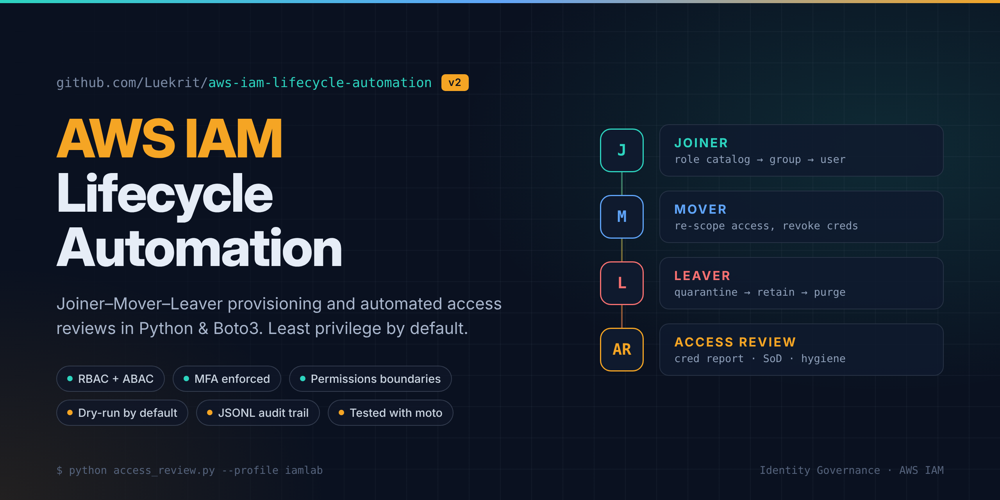

<p align="center">
  
</p>

# AWS IAM Lifecycle Automation: Joiner-Mover-Leaver & Access Review

A hands-on lab that simulates enterprise **Identity and Access Management (IAM)** governance in AWS: the Joiner–Mover–Leaver (JML) lifecycle, done manually first and then automated with Python and Boto3, followed by an automated access review.

> **Version 2 (Nov 2026).** The original 2025 lab was re-reviewed and rebuilt to current practice: least-privilege policies with ABAC, enforced MFA, permissions boundaries, no access keys for people, dry-run-by-default automation, safe leaver offboarding, structured audit logs, an access-review engine, automated tests and secret scanning. See [What changed in v2](#what-changed-in-v2).

---

## Phases

| Phase | What it covers | Main files |
|---|---|---|
| **1. Manual lifecycle** | Create, move and offboard users in the AWS Console to understand each step | `Phase1_.../README.md`, policy JSON files |
| **2. Joiner automation** | Bootstrap RBAC groups and policies; validate a CSV; provision users | `bootstrap.py`, `validate_csv.py`, `Joiner.py`, `Joiner.csv` |
| **3. Mover & Leaver automation** | Role changes with credential revocation; two-stage offboarding (disable now, purge after retention) | `mover_leaver.py`, `mover.py`, `leaver.py`, `mover_leaver.csv` |
| **4. Access review** | Rule-based review of the credential report, entitlements, segregation of duties and leaver hygiene | `access_review.py` |

Shared logic lives in `iam_lifecycle/` (role catalog, AWS session, CSV validation, lifecycle actions, audit log, review rules). Tests live in `tests/`.

---

## Security design

| Control | How it is implemented |
|---|---|
| **No hardcoded identifiers** | Account ID and partition come from `sts:GetCallerIdentity` at runtime. Policies use `*` for the account segment or policy variables. A test and a pre-commit hook fail if an account ID or access key ID is committed. |
| **No long-term keys for people** | The automation never calls `CreateAccessKey` (explicitly denied in the operator policy). Console passwords, if requested, go straight to Secrets Manager and must be reset at first sign-in. |
| **MFA enforced** | `enforce-mfa.json` is attached to every workforce group and denies almost everything until the user signs in with MFA. |
| **Least privilege + ABAC** | Policies are scoped by action, region and the user's `department` tag. HR can only read `iamlab-hr-*` buckets, developers can only manage resources tagged with their department. |
| **Permissions boundary** | Every created user gets `iamlab-user-boundary`, which caps what any policy can grant and blocks audit tampering (CloudTrail/log deletion) and cross-account data sharing. |
| **RBAC through a role catalog** | CSVs contain only `username, role, ticket`. Which group and policies a role maps to is defined in reviewed code (`iam_lifecycle/config.py`), so editing a CSV cannot grant arbitrary permissions. |
| **Blast-radius limit** | All lab identities live under the IAM path `/iamlab/`. The scripts refuse to modify users outside it, and the operator policy is scoped to it. |
| **Scoped automation identity** | Run the scripts through `--role-arn` with `jml-automation-operator.json` instead of an admin user. Prefer an IAM Identity Center profile (`aws configure sso`) over `aws configure` with static keys. |
| **Safe changes** | Dry run by default; `--apply` plus typed confirmation for changes; CSV validated before any AWS call; joiner rolls back half-created users. |
| **Safe offboarding** | Deny-all quarantine first, then every credential type disabled, entitlements removed, user tagged `terminated`. Deletion happens only after the retention period (`leaver.py --purge`). |
| **Auditability** | Every action is written as a JSON line (actor ARN, ticket, dry-run flag, result) to `audit-logs/`, in addition to CloudTrail. |
| **Supply chain & secrets hygiene** | `.gitignore` for credentials and outputs, gitleaks + ruff (incl. bandit rules) in pre-commit and CI, least-privilege CI token, Dependabot. |

---

## Quick start

```bash
python -m venv .venv && source .venv/bin/activate      # Windows: .venv\Scripts\activate
pip install -r requirements-dev.txt
pre-commit install

pytest -q                                              # runs against mocked AWS, no account needed

# Against a sandbox account (never production):
aws configure sso                                      # or use an existing SSO profile
python Phase2_Joiner_automation/bootstrap.py --profile iamlab           # dry run
python Phase2_Joiner_automation/bootstrap.py --profile iamlab --apply
python Phase2_Joiner_automation/Joiner.py --profile iamlab --apply
python Phase3_mover_leaver_automation/mover_leaver.py --profile iamlab --apply
python Phase4_Access_Review/access_review.py --profile iamlab
```

Each phase README has the details.

---

## What changed in v2

| v1 issue (found in review) | v2 fix |
|---|---|
| Screenshots exposed the AWS account ID and access key IDs | Redacted; guardrail test + pre-commit hook added |
| `AmazonS3ReadOnlyAccess` / `s3:Get*` on `*` let HR read every bucket | Department-scoped ABAC policy |
| `ec2:*` and `lambda:*`/`logs:*` on `*` | Scoped developer policies; boundary denies snapshot sharing and log deletion |
| Console users without MFA; access keys issued to every user | MFA enforced; no access keys for people |
| Policies attached directly to users alongside empty groups | Permissions only on groups (RBAC); bootstrap creates them |
| CSV could name any policy/group | Role catalog; CSV only names a role |
| Mover silently created missing users; kept old credentials | Mover refuses unknown users, deactivates keys, forces password reset |
| Leaver crashed on users with access keys, leaving keys active | Deny-all first, all credential types handled, retention then purge |
| Scripts read CSV files that did not exist; READMEs described other scripts | File names and docs match the code; CI validates the CSVs |
| `print()` only, no audit trail | JSONL audit log with actor and ticket |
| No tests | 29 tests against mocked AWS (moto) |

---

## Built with

AWS IAM · AWS STS · AWS Secrets Manager · Python 3.11+ · Boto3 · pytest + moto · ruff · gitleaks · GitHub Actions
